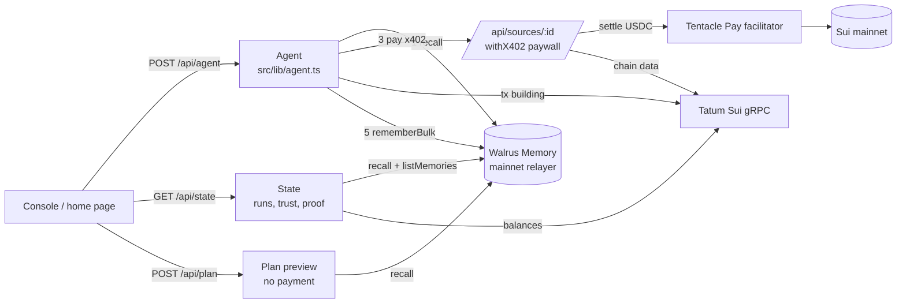

# Spend-Aware Agent

**A research agent that pays for data per request with x402 on Sui, judges what every purchase was worth, and remembers the verdict in Walrus Memory, so it stops paying for sources that don't deliver.**

Built for [Total Recall · Tatum × Walrus Memory Hackathon](https://tatum.io/hackathon/total-recall), track **Smart Agents for Real Life**.

- Live demo: [spend-aware-agent.vercel.app](https://spend-aware-agent.vercel.app)
- Demo video: [youtu.be/XnFfyegpDJY](https://youtu.be/XnFfyegpDJY)
- Blog post: [An agent that stops paying for data it already learned was useless](https://dev.to/chrisgold/an-agent-that-stops-paying-for-data-it-already-learned-was-useless-3kmg)

## For judges: verify it in two minutes

1. Open the [home page](https://spend-aware-agent.vercel.app). The chart is rebuilt live from the agent's Walrus memories: each bar is one paid mainnet run, green where the purchase added facts, red where it added nothing. First runs on a topic carry red; later runs do not.
2. Scroll to **Proof on mainnet**. Every row is one memory with its Walrus blob link and the Sui transaction that paid for the purchase it judges. The memory count comes from the Walrus Memory index.
3. Open the [console](https://spend-aware-agent.vercel.app/console) and press **Preview the plan, free**. It reads memory and shows what the agent will buy next to what a memoryless agent would buy. No payment is made.
4. Press **Run on mainnet** to watch a real run: recall, skip, pay (with tx link), score, write to Walrus. The trust table marks the rows the run updated.

## The problem

Agents are starting to buy things on their own: API calls, data feeds, model inference. Pay-per-request protocols like x402 make that easy. What they don't do is make the agent *careful*. A stateless agent pays for the same redundant or worthless source every single time, because it has no memory of having been burned before.

## What it does

You ask a question about Sui (network health, validators, a token, a wallet). The agent:

1. **Recalls** its past evaluations of every paid data source for that kind of question from Walrus Memory.
2. **Plans** purchases: sources with a good track record first, unknown sources once to learn their value, and sources with a bad track record skipped with an explanation.
3. **Pays** for each purchase with a real USDC micropayment on Sui mainnet through x402 (HTTP `402 Payment Required` → signed payment → settled transaction).
4. **Evaluates** each response: which required facts did it provide that cheaper purchases had not already covered? That marginal usefulness (0–1) is the source's score for this run.
5. **Remembers** one structured evaluation per purchase in Walrus Memory on mainnet, then answers the question.

On the first run of a topic it buys everything relevant (exploration). From the second run on, memory changes its behavior: it buys only what has proven useful and the cost per answer drops by up to ~90%. The ledger in the UI shows what it has learned, and every memory links to its Walrus blob.

### Example: "How healthy is the Sui network right now?"

| Run | Bought | Skipped (from memory) | Spent |
| --- | --- | --- | --- |
| 1 (no memory) | Chain Pulse, Staking Scope, Alpha Wire, Chain Pulse Pro | none | $0.024 |
| 2+ | Chain Pulse | Staking Scope (nothing new), Alpha Wire (no verifiable data), Chain Pulse Pro (duplicates Chain Pulse at 4.5× the price) | $0.002 |

## How it uses Tatum, Walrus and x402

| Piece | Used for |
| --- | --- |
| **Tatum Sui gRPC** (`sui-mainnet-grpc.gateway.tatum.io:443`) | All on-chain data sold by the sources (checkpoints, gas price, epoch and validator set, balances, owned objects, coin info), the wallet balances shown in the UI, and the Sui client the agent uses to build its x402 payment transactions. Uses `SuiGrpcClient` from `@mysten/sui` over a native gRPC transport with the `x-api-key` header (`src/lib/tatum.ts`). |
| **Walrus Memory** (`@mysten-incubation/memwal`, mainnet relayer) | Long-term memory of source evaluations. `recall` before every run, `rememberBulk` + `waitForRememberJobs` after every run. Memories are stored on Walrus and owned by a Sui account. |
| **x402 on Sui** (`@tentaclepay/sui-x402`, `@x402/next`, `@x402/fetch`) | Each data source is a paywalled Next.js route (`withX402`, settles only after a successful response). The agent pays with `wrapFetchWithPayment`. Settlement goes through the Tentacle Pay facilitator, gas-sponsored, in USDC. |

## Data sources

All sources serve live Sui mainnet data read through Tatum's gRPC gateway except Alpha Wire, which is a deliberately low-signal seller that claims every topic and returns no verifiable data. It exists to prove the agent learns to stop paying for it.

| Source | Price | Topics |
| --- | --- | --- |
| Chain Pulse | $0.002 | network |
| Token Intel | $0.003 | token |
| Wallet X-Ray | $0.004 | wallet |
| Staking Scope | $0.005 | staking, network |
| Alpha Wire | $0.008 | all (decoy) |
| Chain Pulse Pro | $0.009 | network, staking (same data as Chain Pulse plus commentary) |

## Architecture



The loop, step by step: **recall** past verdicts for the topic → **plan** (proven sources first, unknown sources once, sources with average usefulness under 0.25 skipped, bad verdicts re-tested after 7 days) → **pay** with x402 → **score** marginal usefulness → **remember** one verdict per purchase. If Walrus Memory cannot be read, the agent refuses to spend rather than buying blind.

| File | Role |
| --- | --- |
| `src/lib/learning.ts` | The learning loop as pure functions: memory encoding, aggregation, planning, scoring, run reconstruction. Unit tested. |
| `src/lib/agent.ts` | One run: recall, plan, pay, score, remember. Streams NDJSON events to the UI. Also the free plan preview. |
| `src/lib/memory.ts` | Walrus Memory client: `recall`, `rememberBulk`, `waitForRememberJobs`, `listMemories` for the authoritative count. |
| `src/lib/tatum.ts` | `SuiGrpcClient` on Tatum's native gRPC gateway with the `x-api-key` header, throttled to the plan's 3 rps with retry on 429. |
| `src/lib/sources.ts`, `src/lib/catalog.ts` | The paid sources: prices and topics (catalog) and their Tatum-backed fetchers. |
| `src/app/api/sources/[id]/route.ts` | x402 paywall per source (`withX402`, settles only after a successful response). |
| `src/app/api/state/route.ts` | Runs, trust table, memory proof and wallet balances for the UI, cached for 15 s. |

Each memory is one line of text, for example:

```
[source-eval] source=alpha-wire topic=network paid_usd=0.008 usefulness=0.00 new_facts=0/5 redundant_with=- tx=<sui digest> at=2026-11-05T14:34:50.365Z run=3f9a1c2e
```

## Run it locally

```bash
pnpm install
pnpm tsx scripts/gen-keys.mts            # creates AGENT_SECRET_KEY and SELLER_SECRET_KEY in .env.local
```

Add to `.env.local`:

```
TATUM_API_KEY=...          # dashboard.tatum.io
MEMWAL_PRIVATE_KEY=...     # delegate key from memory.walrus.xyz
MEMWAL_ACCOUNT_ID=...      # account id from memory.walrus.xyz
```

Fund the agent address with a little USDC on Sui mainnet (no SUI needed; payments are gas-sponsored), then:

```bash
pnpm dev
pnpm tsx --env-file=.env.local scripts/smoke.mts   # checks Tatum, Walrus Memory and a full paid run
```

Tests cover the learning loop (memory round-trip, planning, re-testing stale verdicts, marginal scoring, run reconstruction):

```bash
pnpm test
```

For UI work without keys, point `/api/state` at a saved snapshot (ignored in production): `STATE_FIXTURE=path/to/state.json pnpm dev`.

Optional: `SUI_NETWORK=sui:testnet`, `MAX_RUN_BUDGET_USD` (default 0.05), `RUNS_PER_HOUR` (default 30).

## Limits and honest notes

- Usefulness scoring is deterministic (required facts per topic, marginal over cheaper purchases), not an LLM judge. This keeps the learning loop transparent and reproducible.
- The agent and the sellers are both run by this demo, so the USDC moves between two demo wallets. The payments are nonetheless real mainnet x402 settlements.
- With the default relayer, Walrus Memory's relayer sees memory plaintext. Evaluations contain no personal data.
- The public demo is rate-limited and budget-capped per run. The limiter is in memory, so it is per server instance, not global.
- Memories written before Nov 9 carry no run id. The UI groups those into runs by topic and time (purchases under two minutes apart). Newer memories carry `run=<id>`.

## License

MIT
